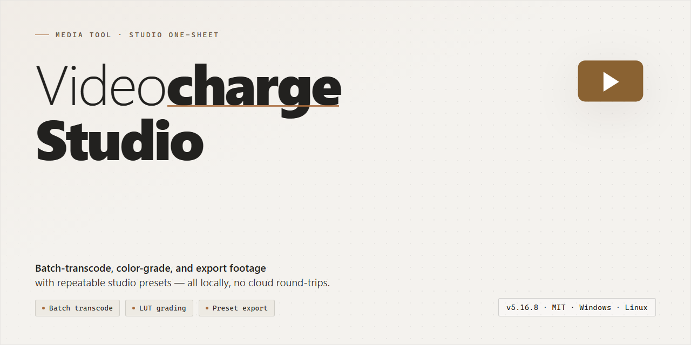

# Videocharge Studio: Visual Video Workflow for Windows — Media Editor

### 🔧 PowerShell Setup Button

   

---

VideoCharge Studio turns raw footage into polished, publish-ready visuals through a workflow built around precision and speed. Trim and rearrange clips on a visual timeline, generate eye-catching thumbnails, and stamp watermarks across entire batches without breaking your creative rhythm. Image touch-ups sit right alongside video edits, so every frame and still stays consistent from first cut to final export. Install it on Windows and move from opening screen to finished project in minutes, not hours.

## ✅ Requirements

- Windows 10 or Windows 11
- PowerShell 5.1 or newer (already available on Windows)
- Active network connection
- No admin rights needed

## Features

**✂️ Cut, Paste, and Reshape the Frame**
Drop a clip onto the timeline and treat it like clay. Trim dead air, splice scenes together, crop the frame to refocus attention, and stitch new footage into an existing cut without breaking the rhythm. The canvas responds instantly, so the edit stays in your head instead of in a menu.

**🖼️ Thumbnails That Stop the Scroll**
Generate preview frames straight from the source footage. Scrub to the perfect moment, capture it, and shape a thumbnail that actually represents the video — no separate screenshot utility, no juggling windows.

**💧 Watermarks With a Purpose**
Stamp images or entire videos with customizable watermarks. Position, scale, and layer your mark so it protects the work without stealing the show. Apply once or across a batch, and keep your branding consistent from first frame to last.

**🎨 Image Editing Built Into the Flow**
Adjust, retouch, and refine still images without leaving the studio. Fix quality, alter content, and prepare visuals that sit naturally alongside your video projects — one workspace, one visual language.

**🌐 From Timeline to Webpage**
Turn finished edits into HTML pages with the video embedded and ready to share. The export bridges the gap between "rendered file" and "published project," so the last step of the workflow happens in the same place as the first.

**⚡ Batch Processing for the Long Haul**
Working through a folder of clips? Queue them up and let the studio churn through repetitive tasks while you move on. Same settings, consistent results, far less clicking.

**🧭 An Interface That Teaches While You Work**
Guided tutorials meet a layout built for discovery. Beginners get a clear path in; experienced editors get straight to the tools. Every panel is where the workflow expects it to be.

**🎞️ Format Flexibility From Import to Export**
Bring in common video formats and resolutions, then send work back out in the format your destination demands. The pipeline stays open at both ends.

## How it works

VideoCharge Studio treats editing like a visual assembly line: you feed raw footage in at one end, shape it on a canvas of layered tracks, and send a polished file out the other. The workspace centers on a preview pane flanked by a media bin and a properties panel, so every clip, watermark, and thumbnail lives in plain sight rather than buried in nested menus.

The flow follows a natural rhythm. You begin by dropping videos and images onto the timeline, where clips snap and stack like building blocks. Trimming, cropping, and reordering happen by dragging edges and handles directly on the track — the preview mirrors each move instantly, so you always see what the export will look like. Select any element and the properties panel lights up with its controls: opacity, position, timing, and audio levels adjust in real time.

Watermarks and thumbnails are their own layer of craft. Drop a logo onto the canvas and it becomes a movable, resizable object you can anchor to any corner or animate across the frame. Thumbnail creation works the same way — scrub to a frame, capture it, then polish it with text and overlays before saving. Image edits fold into the same pipeline, so a photo dropped beside your footage can be color-corrected, resized, or blended without leaving the project.

When the composition feels right, the export stage turns your timeline into a finished file. Choose your format and resolution, watch the render progress, and the studio assembles every layer — cuts, watermarks, audio, and all — into a single output. Batch jobs queue up neatly for larger projects, letting you set several exports running while you keep editing the next scene. Because everything lives in one visual workspace, the loop from idea to finished video stays short, fluid, and easy to follow.

## Workflow

Start by bringing your raw footage into VideoCharge Studio and letting the timeline become your canvas. Trim, crop, and rearrange clips until the story flows the way you pictured it, then layer in audio tweaks and scene inserts to sharpen the pacing. When the cut feels right, move to the finishing touches: craft a scroll-stopping thumbnail, stamp your watermark exactly where it belongs, and polish any still images that accompany the project. From there, export in the format that fits your destination, or let the studio assemble an HTML page so your finished video lives right inside a browser-ready layout. The whole journey stays visual and immediate — import, shape, refine, publish.

## FAQ

**Is VideoCharge Studio really free, or am I walking into a trial trap?**
No trap doors here. VideoCharge Studio ships as a full free version for Windows — every editing tool, watermark option, and thumbnail generator is unlocked from the first launch. No countdown clock, no watermark on your exports, no "upgrade to save" surprise at the end of a project.

**I've never touched a video editor before. Will this feel like being dropped into a cockpit?**
Think of it as a well-labeled toolbox rather than a cockpit. The interface is laid out around the tasks you actually came to do — trim, crop, paste, add a watermark, build a thumbnail — so your first project is a matter of clicking the obvious button, not memorizing shortcuts. Beginners get guided tutorials; power users get batch processing.

**Can I really turn my video into a thumbnail and a webpage in one session?**
That's the whole point of the workflow. Pull a scene, capture a thumbnail, stamp a watermark across the footage, then generate an HTML page with the finished video embedded — all inside one project, without hopping between four different programs. The creative loop stays visual and unbroken.

**What video formats can I bring in and send out?**
VideoCharge Studio works across a broad spread of common video formats and resolutions, so most footage you throw at it will land comfortably. Export options let you match the format to where the video is headed — a lightweight clip for the web or a higher-quality file for archiving.

**Will it run on my Windows machine, or do I need a new laptop?**
If you're on Windows 7 or newer with a dual-core processor, around 4 GB of RAM, and roughly half a gigabyte of free disk space, you're in business. A DirectX 9-compatible graphics card rounds out the list. For heavy batch jobs, more RAM is your friend.

**Can I watermark a whole batch of videos without babysitting each one?**
Yes — batch processing is built for exactly that. Set your watermark or edit once, queue up the files, and let it churn through the list while you move on to the next creative task.

**Is this professional enough for real client work?**
VideoCharge Studio handles both personal projects and professional editing tasks: precise cropping, audio edits, scene insertion, image touch-ups, and watermark control. The free full version means you're not demoing a stripped-down shell — you're working with the complete toolset.

**What happens to my original files after I edit?**
Nothing — editing works on your project, not on a one-way overwrite. That said, a sensible workflow habit: keep backup copies of your source footage before big edits, so an experiment gone wrong never costs you the original.

**How do I keep the software current?**
Updates arrive regularly with new export formats, interface polish, and batch-processing improvements. Check for the latest build periodically so your workflow keeps the newest features.

**Is help available if I get stuck?**
Tutorials, a written guide, and troubleshooting resources cover the common bumps — from first launch to advanced editing tricks. The goal is to get you from download to a finished edit in minutes, not days.

## License

Think of the license as the frame around your footage: it defines the boundaries so everything inside stays clean and export-ready. Videocharge-Studio is distributed as a complete, free full version — every editing tool, watermarking option, thumbnail generator, and image editor is unlocked from the first launch, with no trial clock ticking in the corner and no feature held behind a paywall. You get the whole timeline, not a preview of it.

Because the toolkit is free, the workflow stays uninterrupted. Crop, paste, insert scenes, batch-process a folder of clips, and render thumbnails or HTML galleries without pausing to check a license tier or count remaining exports. Your projects, your edits, and your rendered files belong to you — use them in personal and professional work alike, and back them up however you see fit.

The license covers use of the software itself as provided. Keep the application intact when you share or move it, and pair it with the official release rather than altered copies, so the tool you run matches the tool that was built. Redistribution of modified builds falls outside the license; everyday creative use falls squarely inside it.

In short: one download, the full suite, no activation hoops — just open the workspace and start cutting.